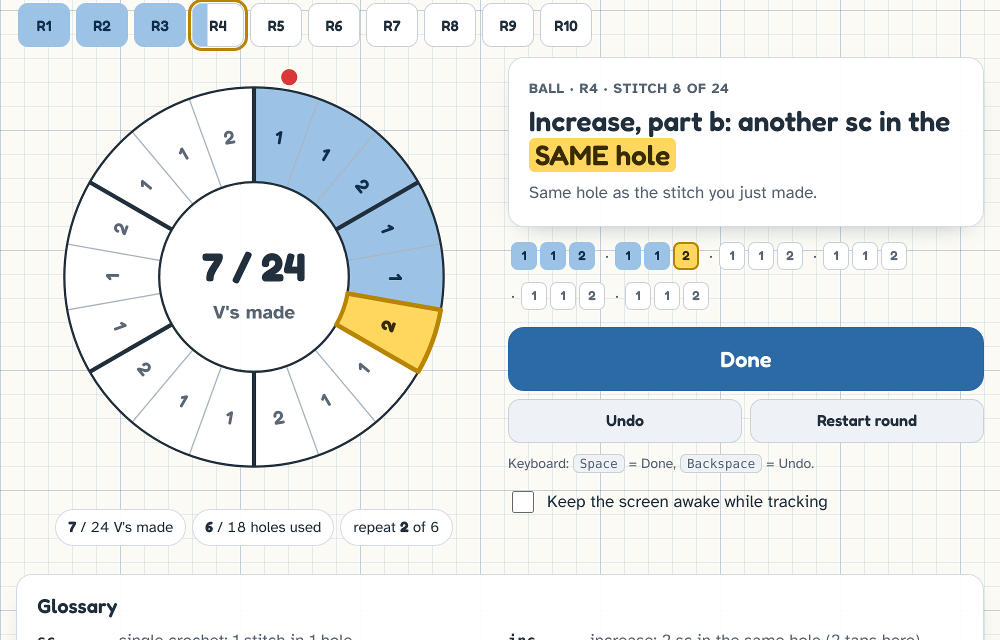

# Crochet Round Tracker

A free, single-page tracker for crocheting in the round. Paste any amigurumi pattern and work through it stitch by stitch on a wheel of holes: one slice per hole of the round below, labelled **1** (sc), **2** (inc) or **dec**, like a paper tally circle. Tap **Done** after every stitch.

**Use it:** <https://bee-san.github.io/crochet/>



Made for beginners who lose count, especially on increases. An increase takes two taps, and the second one tells you to work into the **same** hole. Every round starts with a reminder about the stitch marker.

## Features

- **Pattern view.** Paste a pattern and each round is checked as you type.
- **Track view.** Shows the stitch wheel, the current step in plain words, a tally strip and round chips. It also tells you when a round is complete.
- **Pieces.** Body, belly, arms and so on each get their own tab, and round numbers restart per piece.
- **Saved progress.** Progress for every round is kept on this device, and you can keep several patterns. Export and import a backup file to move between phone and laptop.
- **Keyboard shortcuts.** Space = Done, Backspace = Undo. You can also keep the screen awake while tracking.
- **Private.** No accounts, no analytics, no server. Your pattern never leaves your browser; the only network requests are for fonts.

## Pattern syntax

One round per line, written the way patterns are usually printed. The parser is forgiving and never rejects a whole paste.

| You write | Means |
|---|---|
| `R1: 6 sc in magic ring (6)` or `R1: sc*6 in MR` | 6 sc into the ring |
| `R2: inc*6 (12)`, `R2: inc x6 = 12` or `R2: 6 inc` | 6 increases |
| `R3: (sc, inc)*6 (18)` or `R3: [sc, inc] x 6` | repeat the brackets 6 times |
| `R4: (2sc, inc)*6 (24)` | 1 sc in each of 2 holes, then inc; 6 times |
| `R5: sc around (24)` or `R5: sc*24` | 1 sc in every hole |
| `R6-9: sc*24 (24)` | the same round 4 times (R6 to R9) |
| `R10: (2sc, dec)*6 (18)` | dec = 2 holes worked into 1 |

- **Labels:** `R`, `Rnd` or `Round`, then a number or a range, then an optional `:`.
- **Repeats:** `*`, `x`, `×` or `6 times`.
- **Counts:** a trailing `(N)`, `[N]` or `= N` is the stitch count, and it is checked.
- **Synonyms:**
  - `single crochet` → `sc`
  - `increase` → `inc`
  - `decrease`, `invdec`, `inv dec` and `sc2tog` → `dec`
  - `MR` and `magic ring` → a ring round
- **Pieces:** a line ending in `:` or starting with `#` starts a new piece (`Body:`, `# Belly`).
- **Notes:** any other line becomes a note on the round above it (`Insert eyes between R6 and R7`). Text after the count is a note too: `R12: sc*24 (24) stuff now`.
- **Other stitches:** `hdc`, `bobble` and the like become plain-text steps, so the round still moves forward.

The checker warns, and never blocks you, when:

- the stated count doesn't match the stitches, e.g. "Says 24 but the stitches make 22."
- a round uses a different number of holes than the round below has, e.g. "Uses 30 holes but the round before has 28."
- a line can't be read. The line is quoted back with its line number.

## Development

Plain HTML, CSS and JavaScript modules, with no framework, no bundler and no npm dependencies. GitHub Pages serves the folder as it is.

```
crochet/
  index.html          markup for both views
  style.css           colour tokens (light and dark), layout
  src/parser.js       text -> pieces -> rounds -> items (pure, no DOM)
  src/model.js        items -> steps, counts, warnings (pure, no DOM)
  src/store.js        localStorage, export and import
  src/wheel.js        SVG wheel renderer
  src/example.js      the built-in example (a copy of examples/ball.txt)
  src/app.js          views, events, wiring
  examples/ball.txt   the generic ball pattern
  tests/              node --test
```

Run the tests with Node 20 or newer:

```bash
cd crochet && node --test
```

To try it locally, serve the repository root and open `/crochet/`:

```bash
python3 -m http.server 8000
```

The app ships no designer's pattern. The only example is a generic ball (6, 12, 18, 24 and back down), which is standard construction.

## Licence

MIT. See [LICENSE](LICENSE).
